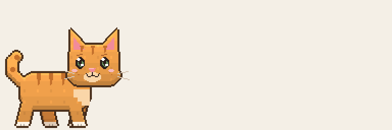
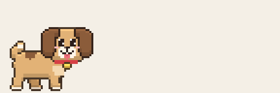

# TOMAGOCHIK

Пиксельные питомцы для рабочего стола macOS: котик, собака или оба сразу.
Приложение написано на Swift и AppKit.




## Сборка и запуск

Нужны Mac с Apple Silicon, macOS 13 или новее и Xcode Command Line Tools со Swift.

```sh
./build.sh
open build/Tamagochi.app
```

Скрипт собирает приложение под arm64 и подписывает его сертификатом `Tamagochi Dev`,
если он есть в связке ключей. Иначе используется временная подпись.

## Управление

- Меню открывается по нажатию на лапку в строке меню или правому клику на питомце.
- В меню можно выбрать питомца, размер, мячик и работу с файлами.
- Двойной клик по питомцу открывает новое напоминание.
- Для взаимодействия с окнами приложению нужен доступ в разделе «Универсальный доступ».

## Файлы проекта

- `app/` — исходники приложения.
- `art/` — Python-скрипты генерации пиксельной графики; требуется Pillow.
- `sprites/` — готовые спрайты для приложения.
- `preview/` — изображения и анимации для просмотра.
- `build.sh` — сборка приложения в `build/Tamagochi.app`.

Сгенерированные сборки в `build/` исключены из Git.
